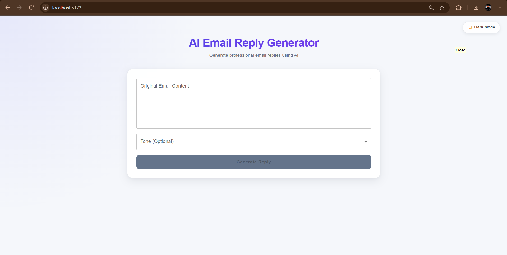
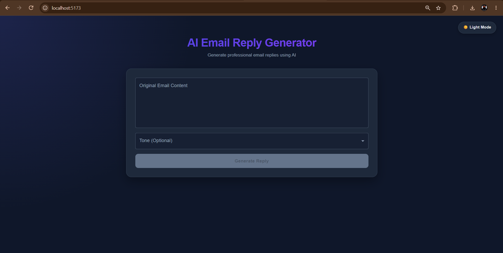

# ✉️ Smart Email Assistant

An AI-powered, full-stack email reply generator built with **Java Spring Boot**, **React**, **Google Gemini API**, and a **Manifest V3 Chrome Extension**. It enables users to generate context-aware, tone-customized email responses either through a standalone web application or directly inside **Gmail** with a single click.

---

## 📋 Table of Contents
- [Features](#-features)
- [System Architecture](#-system-architecture)
- [Tech Stack](#-tech-stack)
- [Screenshots](#-screenshots)
- [Project Structure](#-project-structure)
- [Getting Started](#-getting-started)
  - [Prerequisites](#prerequisites)
  - [1. Backend Setup (Spring Boot)](#1-backend-setup-spring-boot)
  - [2. Frontend Setup (React + Vite)](#2-frontend-setup-react--vite)
  - [3. Chrome Extension Setup](#3-chrome-extension-setup)
- [API Reference](#-api-reference)
- [Contributing](#-contributing)
- [License](#-license)

---

## ✨ Features

- **🤖 Context-Aware AI Replies:** Analyzes incoming email threads and generates relevant, coherent responses powered by the Gemini API.
- **🎭 Customizable Tones:** Tailor responses to match your intent—choose from **Professional**, **Casual**, **Friendly**, or **Concise** tones.
- **🧩 Seamless Gmail Integration:** A custom Chrome Extension injects an **"AI Reply"** button directly into the Gmail compose toolbar, automatically reading the email thread and inserting the generated draft.
- **💻 Standalone Web Interface:** A responsive React & Material UI web application for drafting or refining replies outside of Gmail, complete with one-click copy-to-clipboard functionality.
- **⚡ Fast & Lightweight:** Built with Vite and Spring WebFlux/REST for low-latency API communication.

---

## 🏗️ System Architecture

```text
┌─────────────────────────────┐      ┌─────────────────────────────┐
│   Gmail Chrome Extension    │      │   React + Vite Web App      │
│  (Manifest V3 / Content JS) │      │      (Material UI)          │
└──────────────┬──────────────┘      └──────────────┬──────────────┘
               │                                    │
               └─────────────────┬──────────────────┘
                                 │ HTTP POST (/api/email/generate)
                                 ▼
                 ┌───────────────────────────────┐
                 │     Spring Boot REST API      │
                 │   (Prompt Engineering Layer)  │
                 └───────────────┬───────────────┘
                                 │ REST / WebClient
                                 ▼
                 ┌───────────────────────────────┐
                 │      Google Gemini API        │
                 └───────────────────────────────┘
```

---

## 🛠️ Tech Stack

### **Backend**
- **Java 17+** & **Spring Boot 3**
- **Spring Web / WebFlux** (REST API & non-blocking HTTP client)
- **Google Gemini API** (LLM text generation)
- **Maven** (Dependency management & build tool)

### **Frontend**
- **React 18+** & **Vite**
- **Material UI (`@mui/material`)** (Responsive UI components)
- **Axios** (HTTP client)

### **Browser Extension**
- **Chrome Extensions Manifest V3**
- **Vanilla JavaScript (DOM MutationObserver)** & **CSS3**

---

## 📸 Screenshots

> *Note: Create a `screenshots/` folder in the root directory and add your PNG/GIF captures using the filenames below.*

| Gmail Extension Integration | Web Application Interface |
| :---: | :---: |
|  |  |
|  |  |
| *One-click AI Reply button injected directly into Gmail's compose bar* | *Standalone React & Material UI interface with tone selection* |

---

## 📂 Project Structure

```text
smart-email-assistant/
├── email-writer-backend/          # Spring Boot REST API
│   ├── src/main/java/...          # Controllers, Services, and DTOs
│   ├── src/main/resources/        # application.properties
│   └── pom.xml                    # Maven dependencies
├── email-writer-frontend/         # React + Vite Web Application
│   ├── src/                       # React components & API logic
│   ├── .env.example               # Environment variable template
│   ├── package.json               # NPM dependencies
│   └── vite.config.js             # Vite configuration
├── email-assistant-extension/     # Chrome Extension (Manifest V3)
│   ├── manifest.json              # Extension permissions & configuration
│   ├── content.js                 # Gmail DOM observer & API integration
│   ├── content.css                # Custom button styling
│   └── icon.png                   # Extension icon
├── screenshots/                   # Demo images for README
├── .gitignore                     # Git ignore rules
└── README.md                      # Project documentation
```

---

## 🚀 Getting Started

### Prerequisites
- **Java Development Kit (JDK) 17** or higher
- **Maven 3.8+**
- **Node.js 18+** and **npm**
- **Google Chrome** (or any Chromium-based browser)
- A **Google Gemini API Key** from [Google AI Studio](https://aistudio.google.com/)

---

### 1. Backend Setup (Spring Boot)

1. Navigate to the backend directory:
   ```bash
   cd email-writer-backend
   ```

2. Configure your Gemini API key. Open `src/main/resources/application.properties` and ensure it reads from environment variables (or add your key locally without committing it):
   ```properties
   gemini.api.url=${GEMINI_API_URL}
   gemini.api.key=${GEMINI_API_KEY}
   ```

3. Export your API key in your terminal and run the Spring Boot server:
   ```bash
   export GEMINI_API_KEY="your_actual_gemini_api_key"
   mvn spring-boot:run
   ```
   The backend server will start on **`http://localhost:8080`**.

---

### 2. Frontend Setup (React + Vite)

1. Open a new terminal and navigate to the frontend directory:
   ```bash
   cd email-writer-frontend
   ```

2. Install dependencies:
   ```bash
   npm install
   ```

3. Create a `.env` file from the example template:
   ```bash
   cp .env.example .env
   ```
   Ensure `VITE_API_URL=http://localhost:8080` is set inside `.env`.

4. Start the development server:
   ```bash
   npm run dev
   ```
   Open the local URL shown in your terminal (typically **`http://localhost:5173`**).

---

### 3. Chrome Extension Setup

1. Open Google Chrome and navigate to **`chrome://extensions/`**.
2. Enable **Developer mode** using the toggle in the top-right corner.
3. Click **Load unpacked** in the top-left corner.
4. Select the **`email-assistant-extension/`** folder from this repository.
5. Open [Gmail](https://mail.google.com/), open any email thread, and click **Reply**—you will see the **AI Reply** button appear next to the Send button.

---

## 📡 API Reference

### Generate Email Reply

```http
POST /api/email/generate
Content-Type: application/json
```

#### Request Body
```json
{
  "emailContent": "Hi Team, can we reschedule tomorrow's standup meeting to 11:00 AM? Let me know if that works.",
  "tone": "professional"
}
```

#### Response (`200 OK`)
```text
Hi [Name],

11:00 AM tomorrow works well for me. Thank you for the update, and I look forward to connecting then.

Best regards,
[Your Name]
```

---

## 🤝 Contributing

Contributions, issues, and feature requests are welcome!
1. Fork the repository.
2. Create a new feature branch (`git checkout -b feature/amazing-feature`).
3. Commit your changes (`git commit -m 'feat: add amazing feature'`).
4. Push to the branch (`git push origin feature/amazing-feature`).
5. Open a Pull Request.

---

## 📄 License

Distributed under the **MIT License**. See `LICENSE` for more information.
